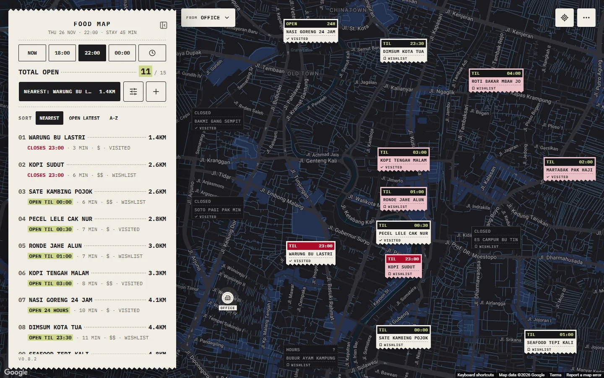
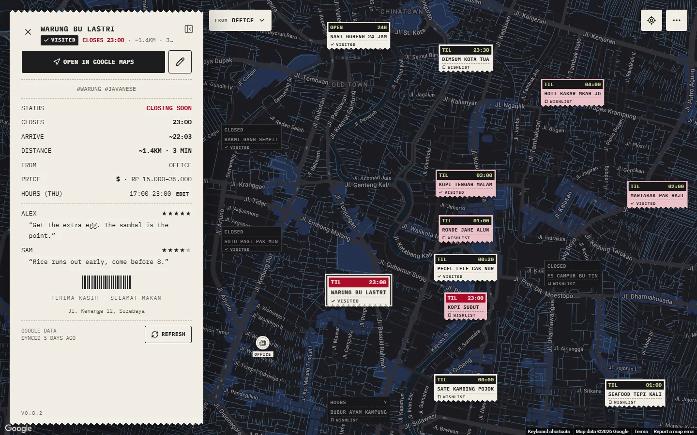
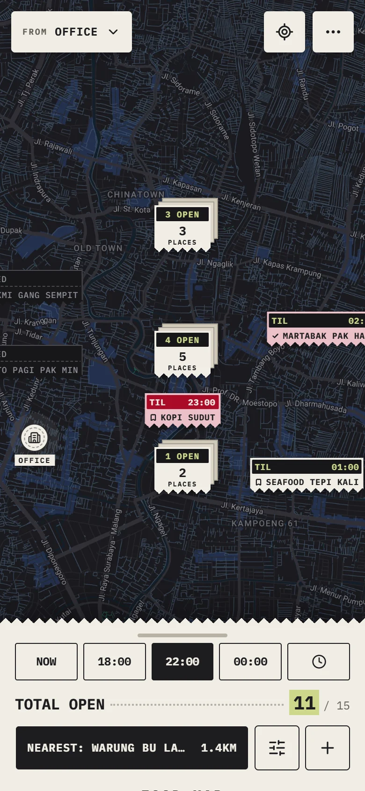
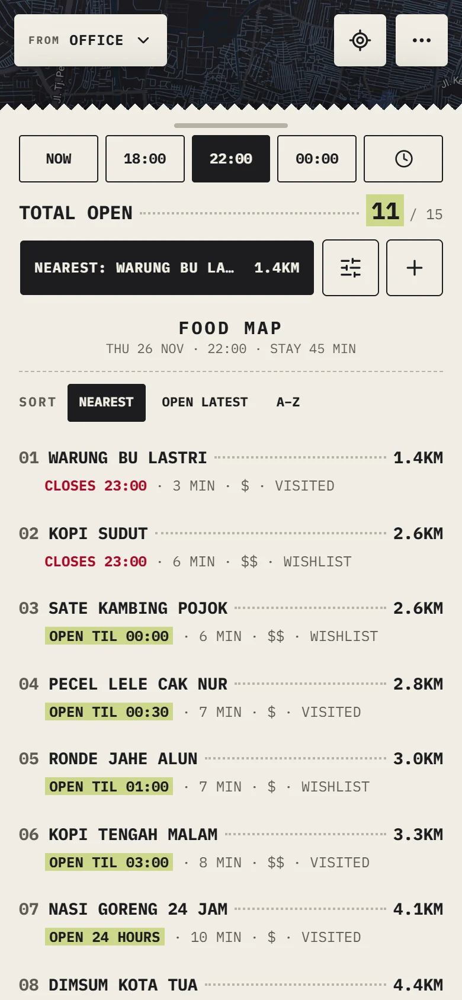
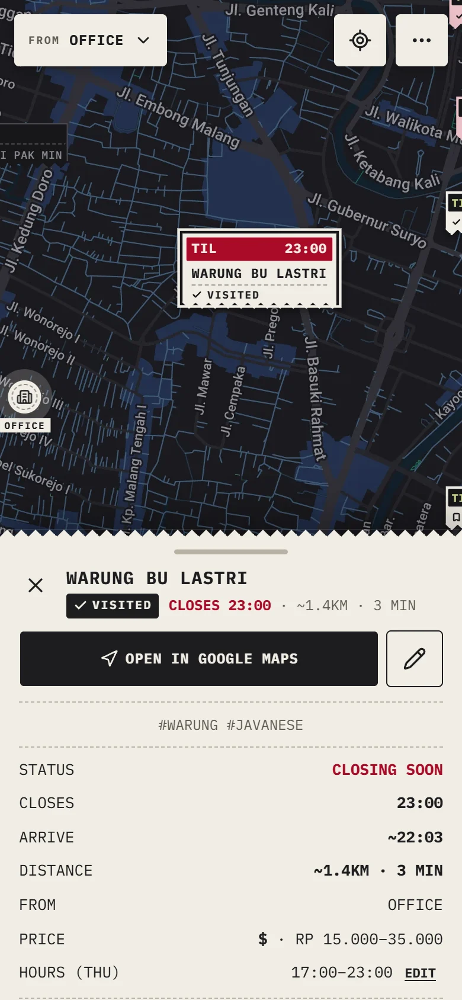

# Food Map

A mobile-first web app that answers one question late at night: **which of the places I've curated are open right now (or at a time I choose), and how far are they?**

It shows only a hand-picked list of food places on a map, and checks each one's opening hours against *when you would arrive*, not just the current time.

<p align="center">
  
  
</p>
<p align="center">
  
  
  
</p>

<sub>Screenshots show the real interface with made-up places and people. Map data © Google.</sub>

## What it does

- **Open at arrival.** A place counts as open only if it is open when you get there *and* stays open for your whole stay (45 minutes by default). Pick "now", a quick time, or any date and time.
- **Distance from where you are.** From your GPS position or a saved starting point (home, work, …), with a rough trip time.
- **Pins are tiny receipts.** Each shows its closing time (lime when open, red when closing soon, muted when closed), the name, and whether you have been there or it is still on the wishlist. On phones, pins that would overlap pile up into a stack of receipts; tap one to zoom in.
- **Your own list.** Add places from a Google search, or by hand when a place isn't on Google. Tag them (type, cuisine, ambient), filter by price, status or tag.
- **Hours you can trust.** Hours come from Google and refresh on their own, or are set by hand with an editor (usual hours, open days, days that differ, past midnight, 24 hours, split shifts). Hours set by hand are never overwritten.
- **Ratings and notes per member.** Each member has their own stars and note on a place, can read the others', and can change only their own.
- **Installable.** Add it to the home screen to open full screen with a splash screen. A light and a dark map, and a one-tap JSON export of everything.

## How it is built

- [Next.js](https://nextjs.org) 16 (App Router, Cache Components), TypeScript, Tailwind CSS v4, [shadcn/ui](https://ui.shadcn.com) on [Base UI](https://base-ui.com)
- [Supabase](https://supabase.com): Postgres and Auth (email and password, sign-ups off) with row-level security, so only members can read or write
- Google Maps JavaScript API and Places API (New), kept inside the free tiers: a daily cron refreshes stale Google data (never more than a few places per run) and keeps the free database awake
- Made for [Vercel](https://vercel.com) (Hobby plan)
- Design: **Struk**, a cashier's receipt on a dark map. IBM Plex Mono only, paper and ink, a lime highlighter for "open"

Opening hours are stored as minute-of-week intervals, which makes "is it open at this moment, for this long?" a plain comparison, including hours that run past midnight. The product rules and the version history are in [SPEC.md](SPEC.md).

## Development

This is a private, members-only app, not packaged for self-hosting: the database schema and seed data are not part of the repository. The code runs against a Supabase project and Google API keys of your own.

```bash
npm install
npm run dev      # http://localhost:5555
npm test         # unit tests for the pure logic (hours, filters, clusters, …)
npm run lint
npm run build
```

Environment variables (names only; values live in `.env.local` and in Vercel):

| Name | Used for |
|---|---|
| `NEXT_PUBLIC_GOOGLE_MAPS_API_KEY`, `NEXT_PUBLIC_GOOGLE_MAP_ID` | the map in the browser |
| `GOOGLE_PLACES_SERVER_KEY` | Places API calls from the server |
| `NEXT_PUBLIC_SUPABASE_URL`, `NEXT_PUBLIC_SUPABASE_PUBLISHABLE_KEY` | database and login |
| `SUPABASE_SECRET_KEY` | the daily cron only (bypasses row-level security) |
| `CRON_SECRET` | authenticates the cron request that Vercel sends |

Releases follow [Semantic Versioning](https://semver.org), one `release/x.y.z` branch per version (see [SPEC.md](SPEC.md)).
